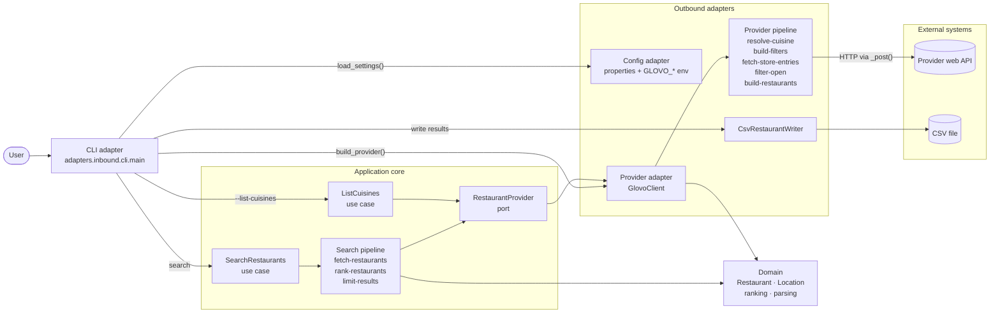
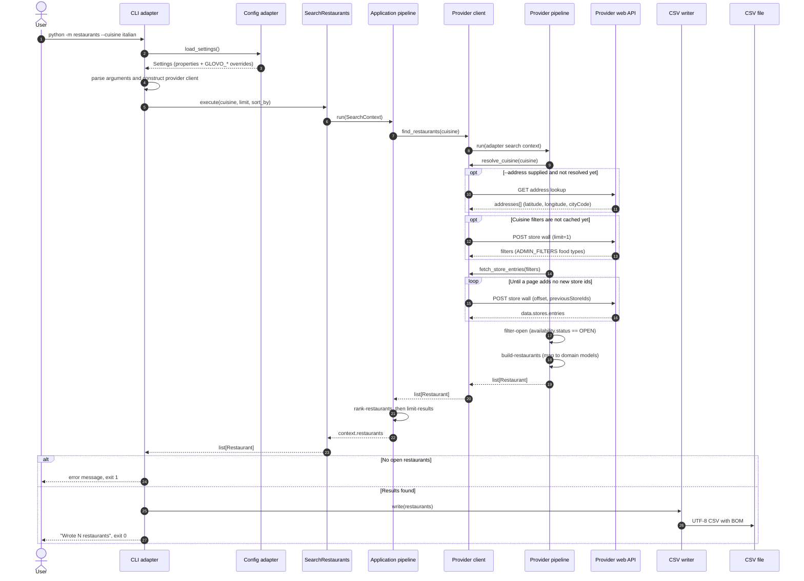

# Architecture and maintainer guide

This document explains how the application is put together, where behaviour
should live, and what to check when a provider changes its private web API.

## High-level flow

The code follows a hexagonal (ports and adapters) architecture:

- **Domain** contains the `Restaurant` entity, `Location` value object, parsing,
  ranking, and domain errors. It has no dependency on HTTP, CLI, configuration,
  or files.
- **Application** contains use cases, the search pipeline, and the ports that
  outbound adapters implement.
- **Adapters** translate between the outside world and the application. The CLI
  parser is an inbound adapter; the HTTP provider client, properties loader,
  and CSV writer are outbound adapters.

Dependencies point inward: adapters depend on the application and domain, the
application depends on the domain and its ports, and the domain depends on
nothing else in the package.

```text
adapters.inbound.cli.main
  -> argparse arguments (cuisine, address, city, sort-by, limit, output)
  -> application.cases.SearchRestaurants.execute(...)
       -> application search pipeline
            fetch-restaurants
                 -> RestaurantProvider.find_restaurants (port)
                      -> provider adapter pipeline
                           resolve-cuisine
                           build-filters
                           fetch-store-entries
                           filter-open
                           build-restaurants
            rank-restaurants (distance | rating | delivery_time)
            limit-results
  -> adapters.outbound.csv_writer.CsvRestaurantWriter.write(...)
```

The application use cases are the core of the application. The CLI owns
argument parsing, user-facing messages, and exit codes; outbound adapters own
HTTP, configuration, and file output.

Provider-specific concerns stay inside the adapter. A different provider can be
added by implementing `RestaurantProvider` (`location`, `cuisine_names`, and
`find_restaurants`) and injecting it into the same use cases and pipeline.

## System diagram

The diagram shows the runtime components and the direction of calls. The
application core can be tested with any `RestaurantProvider`; only the outbound
adapter knows about its provider's HTTP API. The bundled adapter is
`GlovoClient`.



## Search sequence

This traces a normal `--cuisine` search, including optional address resolution,
pagination, availability filtering, ranking, and CSV output. Address resolution
runs only once per client and is cached, so it is shown outside the pagination
loop.



Availability is time-sensitive: only stores whose `availability.status` is
`OPEN` leave the provider pipeline, so result counts naturally vary by hour.
Update both diagrams whenever a stage is added, removed, or reordered in
`build_search_pipeline()` or the adapter pipeline builder.

## Package layout

| File | Responsibility |
| --- | --- |
| `restaurants/domain/restaurant.py` | Provider-neutral `Restaurant` entity. |
| `restaurants/domain/location.py` | `Location` value object for delivery address, city, country, language, and coordinates. |
| `restaurants/domain/helper/options.py` | Supported ranking option constants. |
| `restaurants/domain/helper/parsing.py` | Rating, votes, distance, and ETA parsing helpers. |
| `restaurants/domain/helper/ranking.py` | `sort_restaurants` ranking strategies. |
| `restaurants/domain/errors.py` | Provider-neutral error hierarchy. |
| `restaurants/application/ports.py` | `RestaurantProvider` and `RestaurantWriter` protocols. |
| `restaurants/application/cases/` | One module per use case. |
| `restaurants/application/cases/search_restaurants.py` | `SearchRestaurants` use case. |
| `restaurants/application/cases/list_cuisines.py` | `ListCuisines` use case. |
| `restaurants/application/search.py` | Composition of the provider-neutral search pipeline. |
| `restaurants/application/steps/` | Provider-neutral stages: fetch, rank, and limit. |
| `restaurants/application/search_context.py` | `SearchContext` dataclass shared by pipeline stages. |
| `restaurants/application/pipeline.py` | `Pipeline` dataclass with no provider-specific logic. |
| `restaurants/application/pipeline_step.py` | `PipelineStep` protocol implemented by stages. |
| `restaurants/adapters/inbound/cli.py` | CLI adapter: argument parsing, user-facing messages, and exit codes. |
| `restaurants/adapters/inbound/parser.py` | argparse configuration for the CLI adapter. |
| `restaurants/adapters/outbound/provider.py` | Composition helper that selects the concrete provider adapter. |
| `restaurants/adapters/outbound/glovo_client.py` | Default `RestaurantProvider` adapter: HTTP transport, location resolution, pagination, and search entry point. |
| `restaurants/adapters/outbound/glovo_steps/` | Default adapter pipeline: cuisine lookup, API filters, fetching, availability, and response mapping. |
| `restaurants/adapters/outbound/config.py` | Properties loading and lookup for `config.properties`. |
| `restaurants/adapters/outbound/settings.py` | `Settings` dataclass with validation. |
| `restaurants/adapters/outbound/configuration_error.py` | `ConfigurationError` raised by the configuration adapter. |
| `restaurants/adapters/outbound/csv_writer.py` | CSV output adapter. |
| `restaurants/config.properties` | Provider endpoints, client identity/version pins, pagination, and CLI defaults. |
| `restaurants/__init__.py` | Public package API. Keep this small and stable. |
| `tests/` | Unit tests; no live network calls are required. |

## Ports

The application defines its outbound contracts in
`restaurants/application/ports.py`:

| Port | Implemented by | Purpose |
| --- | --- | --- |
| `RestaurantProvider` | `GlovoClient` (default) or any future adapter | Expose cuisine names and return open `Restaurant` objects for a cuisine. |
| `RestaurantWriter` | `CsvRestaurantWriter` | Persist ranked restaurants. |

To add another provider, implement `RestaurantProvider` in a new outbound
adapter and select it in `adapters.outbound.provider.build_provider()`. No
application or domain changes are required. Application code must not import
adapter modules.

## Pipeline contract

`application.pipeline.Pipeline` is an immutable ordered sequence of steps:

```python
@dataclass(frozen=True)
class Pipeline(Generic[ContextT]):
    steps: tuple[PipelineStep[ContextT], ...]

    def run(self, context: ContextT) -> ContextT:
        for step in self.steps:
            step.run(context)
        return context
```

A step is any object with a `name` attribute and a `run(context)` method.
Steps mutate the shared `SearchContext` and return `None`. Keeping this
contract narrow makes stages easy to test and reorder.

`SearchContext` carries the request and intermediate results:

| Field | Written by | Meaning |
| --- | --- | --- |
| `client` | caller | The `RestaurantProvider` used to fetch restaurants. |
| `cuisine` | caller | User-supplied cuisine query. |
| `sort_by` | caller | Ranking strategy: `distance` (default), `rating`, or `delivery_time`. |
| `limit` | caller | Maximum results after ranking, or `None` for all. |
| `restaurants` | fetch/rank/limit stages | Provider-neutral typed results. |

## Ranking

`domain.helper.sort_restaurants` supports three strategies:

| `sort_by` | Ordering |
| --- | --- |
| `distance` (default) | Parsed distance ascending, then rating, votes, name. |
| `rating` | Rating descending, votes descending, then closest, name. |
| `delivery_time` | ETA midpoint ascending, then closest, rating, votes, name. |

Distance is parsed from strings such as `<100m`, `1.2km`, or `1,2 km`. ETA is
parsed from strings such as `30-40 min` (midpoint), `20 min`, `1h 10 min`, or
`1-2 h`. Unparseable values are treated as missing and sorted last.

## Default search stages

The application pipeline is provider-neutral:

| Stage | Input | Output | Notes |
| --- | --- | --- | --- |
| `FetchRestaurantsStep` | `cuisine` | `restaurants` | Delegates to `RestaurantProvider.find_restaurants`. |
| `RankRestaurantsStep` | `restaurants`, `sort_by` | `restaurants` | Closest first by default; rating or ETA when requested. Missing values go last. |
| `LimitResultsStep` | `restaurants`, `limit` | `restaurants` | Applied after ranking so the limit is meaningful. |

`build_search_pipeline()` is the single place that defines application stage
order. Provider-specific work belongs in the outbound adapter.

### Default adapter stages

The default `GlovoClient.find_restaurants()` runs its own pipeline over
`GlovoSearchContext` before returning domain `Restaurant` objects:

| Stage | Input | Output | Notes |
| --- | --- | --- | --- |
| `ResolveCuisineStep` | `cuisine` | `filter_id` | Uses case/punctuation-insensitive matching and typo suggestions. |
| `BuildFiltersStep` | `filter_id` | `filters` | Builds the provider's cuisine and rating filter payload. |
| `FetchStoreEntriesStep` | `filters` | `entries` | Delegates pagination and deduplication to `GlovoClient.fetch_store_entries`. |
| `FilterOpenStep` | `entries` | `entries` | Keeps only stores whose `availability.status` is `OPEN`. |
| `BuildRestaurantsStep` | `entries` | `restaurants` | Maps provider payloads to domain `Restaurant` objects. |

### Adding an application stage

1. Add a dedicated module under `application/steps/` with a class that has a
   unique `name` and a `run(context)` method.
2. Export the class from `application/steps/__init__.py`.
3. Read and write only the context fields the stage owns.
4. Raise a `ProviderError` subclass for user-facing failures.
5. Add the stage to `build_search_pipeline()` in the correct position.
6. Add a focused test in `tests/test_pipeline.py`.

Example:

```python
class DropUnratedStep:
    name = "drop-unrated"

    def run(self, context: SearchContext) -> None:
        context.restaurants = [
            restaurant
            for restaurant in context.restaurants
            if restaurant.rating is not None
        ]
```

Then insert `DropUnratedStep()` before `RankRestaurantsStep()`.

Provider-specific stages belong under the adapter that needs them, with their
own context type. Do not add provider-specific fields to `SearchContext`.

### Replacing the pipeline

Inject a custom pipeline when constructing the use case. This is the preferred
seam for tests or embedders:

```python
pipeline = Pipeline(
    (FetchRestaurantsStep(), RankRestaurantsStep(), LimitResultsStep())
)
use_case = SearchRestaurants(client, pipeline=pipeline)
restaurants = use_case.execute("italian")
```

## Default provider adapter responsibilities

`GlovoClient` is the default outbound adapter implementing `RestaurantProvider`.
It should not know about application ranking, CSV formatting, or user-facing
messages. Its jobs are:

- Implement `find_restaurants()` by running the adapter-specific pipeline.
- Build the provider's required headers.
- Resolve an optional delivery address to coordinates and a city code.
- Page through the provider's store-wall endpoint and deduplicate store ids.
- Map provider responses to domain `Restaurant` objects.
- Raise typed errors for request and response failures.

Important implementation details:

- `find_restaurants()` is the `RestaurantProvider` entry point. It delegates to
  the adapter pipeline builder.
- `fetch_store_entries()` is the pagination boundary. Availability filtering
  happens in the adapter's `FilterOpenStep` so transport code stays reusable.
- `_resolve_location()` runs lazily on the first request. It appends the city
  to the address only when the city is not already present.
- The address and coordinates are cached for the lifetime of the client.
- `api.page_size` in `config.properties` controls how many stores are requested per HTTP call.

## Default provider API assumptions

The default adapter uses unofficial web endpoints that can change without
notice. Edit `restaurants/config.properties` first; the outbound configuration
adapter validates the values and the provider client consumes them.

| Property | Purpose |
| --- | --- |
| `api.store_wall_url` | Store-wall/category endpoint. |
| `api.address_lookup_url` | Public address autocomplete/resolution endpoint. |
| `api.client_info`, `api.app_version`, `api.api_version` | Spoofed web-client identity headers. |
| `api.request_ttl`, `api.referer`, `api.user_agent` | Request identity/transport headers. |
| `api.page_size` | Stores requested per pagination call. |
| `defaults.*` | CLI/client city, country, language, timeout, limit, and sort defaults. |

Request identity headers include device/session/client UUIDs generated per
client instance and timestamps refreshed per request. The delivery location is
expressed through:

- `glovo-location-city-code`
- `glovo-location-country-code`
- `glovo-delivery-location-latitude`
- `glovo-delivery-location-longitude`
- `glovo-delivery-location-accuracy`
- `glovo-delivery-location-timestamp`

When the API changes, verify these areas in order:

1. A single store-wall request still returns `data.stores.entries`.
2. Pagination still accepts `offset`, `limit`, and `previousStoreIds`.
3. Availability is still `entry["availability"]["status"]`.
4. Address lookup still returns `addresses[]` with `latitude`, `longitude`,
   `cityCode`, and `countryCode`.
5. The pinned `glovo-app-version` still returns `200` rather than `403`.

## Error handling and exit codes

`ProviderError` covers runtime API/search failures:

- `CuisineNotFoundError`: unknown cuisine; includes suggestions when possible.
- `AddressNotFoundError`: address lookup succeeded but no geocodable match.
- `ProviderError`: transport, unexpected response, or address lookup failures.

`ConfigurationError` is raised by the outbound configuration adapter for
missing files, missing keys, unparseable values, or invalid defaults. The CLI reports it as a configuration
error and exits with code `1`.

The CLI maps errors as follows:

| Condition | Exit code |
| --- | --- |
| Success | `0` |
| No restaurants found or provider/address failure | `1` |
| Unknown cuisine | `2` |
| Invalid arguments | `2` (argparse) |
| Invalid/missing configuration | `1` |

Branch on exception types, not message text. If a new user-facing failure mode
is needed, add a `ProviderError` subclass and handle it in `cli.main`.

## Testing strategy

Run the suite from the repository root:

```bash
python -m unittest discover -s tests -v
```

Guidelines:

- Unit tests must not call a live provider API.
- `tests/test_client.py` uses a fake client/session to test pagination, address
  headers, and closed-store filtering.
- `tests/test_glovo_steps.py` covers default-adapter response mapping and availability.
- `tests/test_config.py` covers properties parsing, validation, overrides, and
  client settings wiring.
- `tests/test_pipeline.py` tests the pipeline contract and the provider-neutral
  stage composition.
- `tests/test_models.py` covers rating/votes/distance/ETA parsing and all ranking strategies.
- When changing a stage, add a test at the stage or pipeline level. When
  changing transport, add a test with a fake session.

For an occasional live smoke test:

```bash
python -m restaurants --cuisine italian --address "Carrer de Casp 111" --limit 3
python -m restaurants --cuisine italian --sort-by delivery-time --limit 3
```

Avoid running live requests in a tight loop.

## Maintenance checklist

Before merging a change:

- [ ] `python -m unittest discover -s tests -v` passes.
- [ ] New behaviour is implemented as a pipeline stage, not in the CLI.
- [ ] HTTP changes stay inside the provider adapter.
- [ ] Public functions/classes have docstrings.
- [ ] CLI help, `README.md`, and `config.properties` describe the current options.
- [ ] Version/identity changes are made in `config.properties`, not hard-coded.
- [ ] Closed-store handling still happens before ranking and limiting.
- [ ] The default ranking remains closest-first and every `--sort-by` option has a test.
- [ ] No secrets or personal addresses are committed to fixtures.

## Configuration resolution

`adapters.outbound.config.default_config_path()` selects the first available source:

1. `GLOVO_CONFIG` environment variable.
2. `config.properties` in the current working directory.
3. `config.properties` at the source checkout root.
4. The packaged `restaurants/config.properties`.

`load_settings()` then applies the `DELIVERY_ADDRESS`, `DELIVERY_CITY`, and
`DELIVERY_CITY_CODE` environment variables on
top of the properties file. `get_settings()` reloads this resolved
configuration on each call. Tests and embedders that need isolated settings
should call `load_settings(path)` or pass a `Settings` instance to the provider
adapter.

## Known limitations

- The default provider's web API is unofficial and version-pinned.
- Address matching depends on the provider's autocomplete; ambiguous addresses
  may need a street number or postal code.
- City-only searches rely on the supplied `--city-code`; use `--address` when
  the city code is unknown.
- Some stores may be visible for a city but not deliverable to every address.
- Distance/ETA ranking depends on the display strings the provider returns;
  unknown or unexpected formats are placed after parseable values.
- The CSV writer is a terminal adapter, not a pipeline stage. If output grows
  (for example JSON or a database sink), introduce a separate output pipeline
  rather than coupling it to search.
